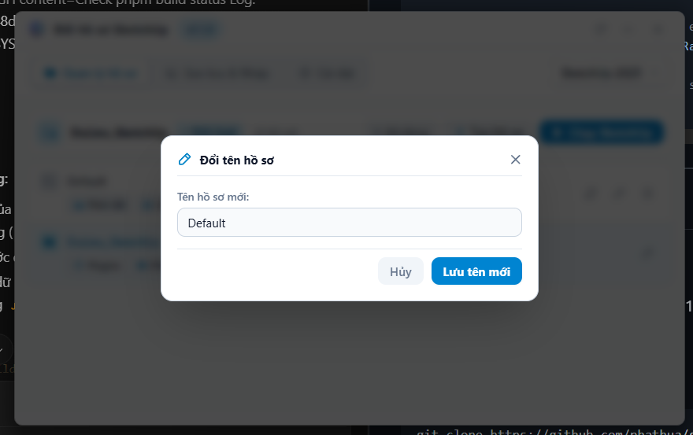
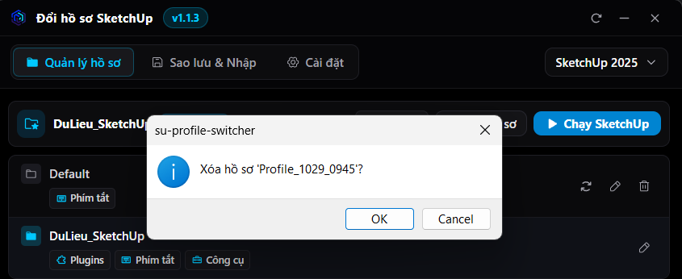

# SketchUp Profile Switcher (SuPS)

<p align="center">
  
</p>

<p align="center">
  <strong>Ultra-lightweight, safe, and high-performance profile switcher for SketchUp.</strong><br>
  Built with <strong>Tauri v2</strong>, <strong>Svelte 5</strong>, and <strong>Rust</strong>.
</p>

<p align="center">
  <a href="#-key-features">Features</a> •
  <a href="#-screenshots">Screenshots</a> •
  <a href="#-download--installation">Download</a> •
  <a href="#-usage-guide">Usage</a> •
  <a href="#-tech-stack">Tech Stack</a> •
  <a href="README.md">Tài liệu tiếng Việt</a>
</p>

---

## 📸 Screenshots

| Main Dashboard (Dark Mode) | Safe Deletion Confirmation |
| :---: | :---: |
|  |  |

---

## ⚡ Key Features

- 🚀 **Blazing Fast & Ultra-Lightweight**: Minimal memory footprint (~20MB RAM), independent of bulky runtimes or full Chromium browsers.
- 🎨 **Visual Profile Customization**: Freely select Phosphor Icons (curated design & 3D workflow icons), assign accent colors, and manage distinct configurations.
- 👁️ **Profile Inspector**: Quickly inspect installed plugins and view customized keyboard shortcuts diffed against default SketchUp 2026 shortcuts.
- 💾 **System Tray Quick-Save**: Save the current workspace directly from the System Tray with an embedded icon and accent color picker without opening the main window.
- ⌨️ **Global Hotkeys**: Switch profiles from anywhere with registered system-wide shortcuts (e.g., `Ctrl+Alt+1`, `Ctrl+Shift+D`).
- 🔔 **Windows Native Notifications**: Pure WinRT Toast Notification integration with custom AUMID and application icon branding.
- 🛡️ **Data Integrity Protection**: Real-time process monitoring detects active SketchUp instances, prompting confirmation and offering single-click **Force Close** protection.
- 🔍 **Multi-Version Auto Detection**: Seamlessly detects and manages configurations across SketchUp 2021 through SketchUp 2026.
- 🧩 **Render Plugin Isolation**: Keep render engines (V-Ray, Enscape, D5 Render, Thea Render) intact to avoid licensing and path issues.
- 📦 **Zip Backup & Migration**: Export portable `.zip` archives of any profile for easy migration or teamwork sharing.

---

## 📥 Download & Installation

Grab the latest installer from the [**GitHub Releases**](https://github.com/phathua/su-profile-switcher/releases) page:

### Installer Packages (NSIS Setup - Recommended)
- `SuPS-x64-v*-Setup.exe`: Automated installer for standard 64-bit Windows.
- `SuPS-x86-v*-Setup.exe`: Automated installer for 32-bit Windows.
- `SuPS-arm64-v*-Setup.exe`: Automated installer for Windows on ARM (Surface Pro Copilot+, Snapdragon X Elite).

> 💡 **AppData User Scope**: Installs by default into `%LOCALAPPDATA%\Programs\SketchUp Profile Switcher` without requiring administrative (UAC) elevation, allowing smooth seamless in-place updates.

---

## 🖥️ Usage Guide

1. **Select Version**: Pick your target SketchUp version from the top-right dropdown.
2. **Create Profile**: Click `+ New Profile`, specify a name, and check target components (Plugins, Shortcuts, Toolbars, Materials, Templates).
3. **Inspect Profile**: Click the eye icon next to any profile to inspect installed plugins and shortcut diffs against SketchUp 2026 defaults.
4. **Customize Profile & Hotkeys**: Click the pencil icon on any profile item to choose an icon, color dot, and record a global shortcut.
5. **Switch Configuration**:
   - Click the switch icon next to the profile in the list.
   - Or right-click the System Tray icon to switch instantly.
   - Or trigger the assigned global keyboard shortcut.
6. **Quick Save from Tray**: Right-click the tray icon and select `Lưu hồ sơ hiện tại...` to open the quick-save modal with color and icon selectors.
7. **Launch / Terminate SketchUp**: The top header button dynamically adapts between `Launch SketchUp` (Sky Blue) and `Force Close SketchUp` (Red) based on the process state.

---

## Command-Line Interface (CLI - sups)

The package includes a ultra-fast, native console binary `sups` (~1.3MB) with sub-5ms cold-start:

```bash
# List profiles in text or machine-readable JSON format
sups list --version "SketchUp 2026"
sups list --json

# View active profile, configuration hash, and match status
sups current

# Safely switch to target profile
sups switch "Production V-Ray" --force

# Save active configuration snapshot
sups save "Backup_2026" --no-shortcuts

# Check running process status
sups sketchup status --json
```

---

## Model Context Protocol (MCP Server)

Built-in native Rust stdio JSON-RPC 2.0 MCP Server for autonomous AI agents (Antigravity, Claude Desktop, Cursor, Codex, Windsurf):

```bash
sups mcp
```

Full AI documentation available in [docs/mcp/README.md](docs/mcp/README.md):
- [AI Agent Operating Guide](docs/mcp/ai_agent_guide.md)
- [Client Integration Guide](docs/mcp/integration_guide.md)
- [8 MCP Tools Schema Reference](docs/mcp/tools_reference.md)

---

## 🛠️ Tech Stack

- **Core Engine**: [Rust](https://www.rust-lang.org/) + [Tauri v2](https://v2.tauri.app/) (WinRT Notification, Windows 0.57)
- **Frontend Framework**: [Svelte 5](https://svelte.dev/) (Runes reactivity)
- **Styling**: [Tailwind CSS v4](https://tailwindcss.com/)
- **Icon System**: [Phosphor Icons](https://phosphoricons.com/)
- **Installer**: NSIS Per-user AppData setup packages
- **CI/CD Pipeline**: GitHub Actions with Node.js 24, multi-architecture packaging (x64, x86, arm64), and automated changelog releases.

---

## 📄 License

Licensed under the [MIT License](LICENSE).
